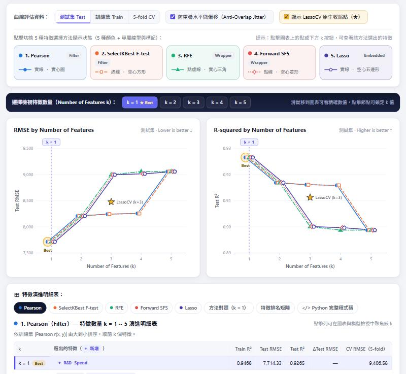

# AIoT DIC2：多元線性回歸 × 5 種特徵選擇方法（50 Startups & Boston Housing）

**線上網頁（GitHub Pages）：<https://jua91352.github.io/AIoT-DIC2-MultipleLR/>**

依 CRISP-DM 流程完成兩個多元線性回歸問題，並依老師調整後的需求，比較 **5 種特徵選擇方法**在特徵數 k = 1 ~ K 的 Test RMSE 與 R²（5 條折線）。網頁是純前端的互動式逐步解析：下拉選單切換題目，也可以輸入任意 CSV 資料集網址。




## 作業要求對照

- [x] 兩個問題都完成：Problem 1 — 50 Startups、Problem 2 — Boston Housing
- [x] 5 種特徵選擇方法（5 條折線）：Pearson、SelectKBest、RFE、Forward SFS、Lasso，k = 1 ~ K 的 RMSE / R² 1×2 雙軌跡折線圖
- [x] 第二題直接套用 skill：[`.claude/skills/mlr-crisp-dm`](.claude/skills/mlr-crisp-dm/SKILL.md)
- [x] 加分 +1：有下拉選單呈現兩種 problem
- [x] 加分 +2：可任意輸入 Dataset 網址（GitHub 檔案頁網址會自動轉成 raw，也可上傳本機 CSV）
- [x] 部署到 GitHub Pages

## 5 種特徵選擇方法

每個方法對每個 k 選出 k 個特徵，再用 OLS（`LinearRegression`）在訓練集重新配適、於測試集評估。

| # | 方法 | 類型 | 做法（scikit-learn） | 圖上樣式 |
|---|---|---|---|---|
| 1 | Pearson | Filter | 訓練集 \|r(x, y)\| 由大到小 | 實線 · 實心圓 |
| 2 | SelectKBest | Filter | `SelectKBest(f_regression)`；F = (n−2)·r²/(1−r²) 是 \|r\| 的單調函數，排序與 Pearson 相同，**兩線重疊是正確結果** | 虛線 · 空心方形 |
| 3 | RFE | Wrapper | `RFE(LinearRegression)`，標準化特徵、每輪移除 \|係數\| 最小者 | 點虛線 · 實心三角 |
| 4 | Forward SFS | Wrapper | `SequentialFeatureSelector(forward, cv=KFold(5, shuffle=True, random_state=42))` | 點線 · 空心菱形 |
| 5 | Lasso | Embedded | `LassoCV(cv=同上)` 收縮後的 \|係數\| 由大到小；★ = LassoCV 原生收縮模型 | 實線 · 空心五邊形 |

共同設定：One-hot `drop_first`、`train_test_split(test_size=0.2, random_state=42)`、`StandardScaler` 只用訓練集 fit。50 Startups 的 5 條線與 ★（LassoCV k = 3、RMSE 8,477.43、R² 0.9113）都和老師的範例圖一致。

## 結果摘要

| | Problem 1 — 50 Startups | Problem 2 — Boston Housing |
|---|---|---|
| 目標 y | `Profit`（年度利潤） | `medv`（房價中位數，千美元） |
| 資料 | 50 筆、One-hot 後 K = 5（`State` → Florida / New York，基準 California） | 506 筆、K = 13 |
| 切分 | 訓練 40 / 測試 10 | 訓練 404 / 測試 102 |
| 全特徵模型 Test RMSE / R² | 9,055.96 / 0.8987 | 4.9286 / 0.6688 |
| 最佳 (方法, k) | k = 1（5 種方法一致）：`R&D Spend` | k = 7（RFE、Lasso）：`lstat` `rm` `ptratio` `dis` `nox` `tax` `rad` |
| 最佳 Test RMSE / R² | **7,714.33 / 0.9265** | **4.8995 / 0.6727** |
| 方法分歧 | k = 3 起 Wrapper / Embedded 加入 `Administration`，Filter 加入 `State_New York` | Lasso 在 k = 3、4 明顯較差；Forward SFS 在 k = 10 的 CV RMSE 最低 |
| LassoCV ★ | α = 657.95，k = 3，RMSE 8,477.43 | α = 0.00686，k = 13，RMSE 4.9313 |
| 完整報告 | [reports/50_startups/report.md](reports/50_startups/report.md) | [reports/boston_housing/report.md](reports/boston_housing/report.md) |

**Problem 1 結論**：利潤幾乎由研發支出決定；只用 `R&D Spend` 的單特徵模型測試誤差最低（比全特徵模型低 14.8%），5 種方法在 k = 1、2 的選擇完全相同。

```
Profit = 49,337 + 0.85361 × R&D Spend
```

**Problem 2 結論**：`lstat`（低社經人口比例）與 `rm`（房間數）是所有方法最先選入的兩個特徵；7 個特徵的 RFE / Lasso 組合測試誤差最低。測試集較大（102 筆）時，各方法的差距比 50 Startups 小。

## 網頁功能

- **頂部**：任務下拉選單、CSV 網址 / 本機上傳、進階設定（目標、特徵、test_size、random_state），以及 5 個重點指標
- **CRISP-DM 逐步解析（Step 1 ~ 6）**：商業理解 → 資料理解 → 資料準備 → 建模 → 評估 → 部署；每一步都有「套用檢視」按鈕，自動設定圖表（例如只看 Filter 兩條線、改看訓練集曲線、聚焦方法分歧最大的 k）
- **圖表設定**：測試集 / 訓練集 / 5-fold CV 曲線切換、防重疊水平微偏移、LassoCV ★ 開關、點擊方法卡片顯示或隱藏折線
- **雙軌跡折線圖**：RMSE 與 R² vs k（X 軸固定為整數 k），滑鼠移上去看 5 種方法的數值與新增特徵，點擊節點鎖定 k
- **特徵演進明細表**：每個方法 k = 1 ~ K 選出的特徵（標示新增者）、方法對照、特徵排名矩陣、**Python 完整程式碼**（scikit-learn，執行結果與網頁相同）
- **模型檢視與即時預測**：任選 (方法, k) 或 LassoCV，顯示方程式、實際 vs 預測散佈圖、係數檢定表，拖曳滑桿即時預測並給出 95% 預測區間

網址參數：`?problem=startups`、`?problem=boston`，或 `?url=<CSV 網址>&target=<目標欄位>`。

## 第二題：直接套用 skill

分析流程封裝成 Claude Code skill（[`SKILL.md`](.claude/skills/mlr-crisp-dm/SKILL.md) + [`mlr_pipeline.py`](.claude/skills/mlr-crisp-dm/scripts/mlr_pipeline.py)）。Problem 2 只要給資料網址和目標欄位，一行指令就產生完整報告與 5 種方法的雙軌跡折線圖：

```bash
python .claude/skills/mlr-crisp-dm/scripts/mlr_pipeline.py \
  --url https://raw.githubusercontent.com/selva86/datasets/master/BostonHousing.csv \
  --target medv --name "Problem 2 — Boston Housing" --slug boston_housing
```

在 Claude Code 裡也可以直接呼叫：`/mlr-crisp-dm <CSV 網址> <目標欄位>`。

## 專案結構

```
├── index.html                      # GitHub Pages 網頁
├── assets/
│   ├── css/style.css
│   └── js/
│       ├── mlr.js                  # 計算引擎：切分、OLS 檢定、VIF、5 種特徵選擇、LassoCV（無外部套件）
│       ├── plot.js                 # SVG 圖表：雙軌跡折線圖、實際 vs 預測散佈圖
│       └── app.js                  # 介面：任務選單、資料集網址、逐步解析、明細表、即時預測
├── .claude/skills/mlr-crisp-dm/    # 第二題套用的 skill
│   ├── SKILL.md
│   └── scripts/mlr_pipeline.py     # Python 版流程（pandas / scikit-learn / matplotlib）
├── reports/
│   ├── 50_startups/                # Problem 1 報告、results.json、圖表
│   └── boston_housing/             # Problem 2 報告、results.json、圖表
└── docs/                           # README 截圖
```

## 本機執行

```bash
python -m http.server 8000
```

開啟 <http://localhost:8000>。重新產生報告需要 `numpy pandas scipy scikit-learn matplotlib`。

## 驗證

網頁（JavaScript）與 Python（scikit-learn）是兩份獨立實作：

- 切分：網頁用 numpy 的 MT19937 重現 `train_test_split(random_state=42)` 與 `KFold(shuffle=True)` 的亂數排列，兩個資料集的訓練 / 測試索引逐筆相同。
- 5 種方法的特徵排序完全相同；每個 (方法, k) 的 Test RMSE、Test R²、Train R²、CV RMSE 相對誤差 < 1e-11。
- LassoCV 的 α、保留特徵數與 Test RMSE 一致（Python 端用 `tol=1e-10` 收斂到精確解）。

## 資料來源與備註

- 50 Startups：[Avik-Jain/100-Days-Of-ML-Code](https://github.com/Avik-Jain/100-Days-Of-ML-Code/blob/master/datasets/50_Startups.csv)
- Boston Housing：[selva86/datasets](https://github.com/selva86/datasets/blob/master/BostonHousing.csv)
- Boston Housing 的變數 `b` 由黑人人口比例計算而來，有倫理爭議（scikit-learn 1.2 起已移除此資料集）。這裡沿用作業指定的經典資料集；網頁上可以取消勾選 `b` 比較結果。
- 依作業範例用測試集比較 k；測試集很小（50 Startups 只有 10 筆）時，請同時參考網頁上的 5-fold CV 曲線。

本作業使用 Claude Code 協作完成。
