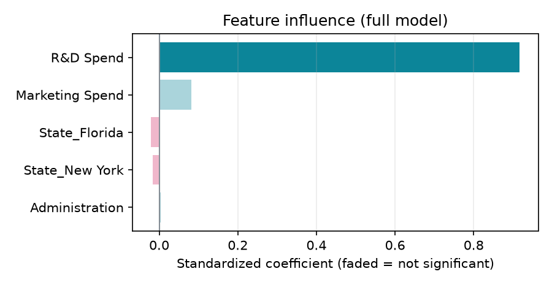
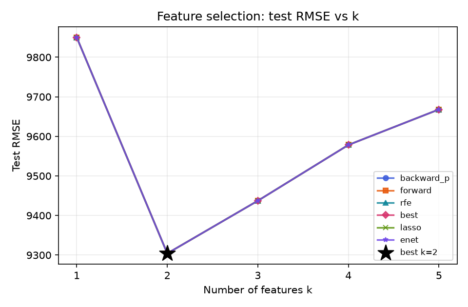

# Problem 1 — 50 Startups：多元線性回歸分析報告（CRISP-DM）

> 由 `mlr-crisp-dm` skill 產生 · 資料來源：<https://raw.githubusercontent.com/Avik-Jain/100-Days-Of-ML-Code/master/datasets/50_Startups.csv> · 2026-10-14 20:26

## 1. Business Understanding 商業理解

創投公司想知道新創公司的支出結構與所在州別如何影響年度利潤：研發（R&D Spend）、行政（Administration）、行銷（Marketing Spend）支出以及所在州（State），哪些因素真正影響利潤（Profit）？以多元線性回歸建立利潤預測模型，再用逆向淘汰與特徵選擇找出最精簡且準確的特徵組合，作為投資判斷依據。

- 目標變數 y：`Profit`
- 候選特徵 X：`R&D Spend`, `Administration`, `Marketing Spend`, `State`

## 2. Data Understanding 資料理解

資料共 **50 筆 × 5 欄**，缺失值 0 個。

| 欄位 | 型態 | 缺失 | 唯一值 | 備註 |
|---|---|---|---|---|
| R&D Spend | 數值 | 0 | 49 |  |
| Administration | 數值 | 0 | 50 |  |
| Marketing Spend | 數值 | 0 | 48 |  |
| State | 類別 | 0 | 3 |  |
| Profit | 數值 | 0 | 50 | 目標 y |

**敘述統計**

| 欄位 | count | mean | std | min | 25% | 50% | 75% | max |
|---|---|---|---|---|---|---|---|---|
| R&D Spend | 50 | 73,722 | 45,902 | 0 | 39,936 | 73,051 | 101,603 | 165,349 |
| Administration | 50 | 121,345 | 28,018 | 51,283 | 103,731 | 122,700 | 144,842 | 182,646 |
| Marketing Spend | 50 | 211,025 | 122,290 | 0 | 129,300 | 212,716 | 299,469 | 471,784 |
| Profit | 50 | 112,013 | 40,306 | 14,681 | 90,139 | 107,978 | 139,766 | 192,262 |

**State 類別分布**：California 17 筆、Florida 16 筆、New York 17 筆

**與目標的相關係數（依絕對值排序）**：`R&D Spend` +0.973、`Marketing Spend` +0.748、`Administration` +0.201

## 3. Data Preparation 資料準備

- 缺失值：無缺失值，不需處理
- One-hot encoding：`State` → `State_Florida`, `State_New York`（基準類別 `California`，drop first 避免 dummy variable trap）
- 訓練/測試切分：訓練 40 筆、測試 10 筆（test ratio 0.2、seed 42，mulberry32 洗牌，與網頁版相同）
- 模型直接使用原始單位（不標準化），另以標準化係數比較各特徵影響力

## 4. Modeling 建模

### 4.1 全特徵模型（OLS）

`Profit = 46,170 + 0.81184 × R&D Spend + 0.0065656 × Administration + 0.026355 × Marketing Spend − 1,734.4 × State_Florida − 1,355.1 × State_New York`

| 變數 | 係數 | 標準誤 | t | p 值 | 95% 信賴區間 | VIF | 標準化係數 |
|---|---|---|---|---|---|---|---|
| (Intercept) | 46,170 | 7,819.2 | 5.905 | 1.14e-06 *** | [30,280, 62,061] | — | — |
| **R&D Spend** | 0.81184 | 0.050644 | 16.030 | 2.03e-17 *** | [0.70892, 0.91476] | 2.261 | 0.917 |
| Administration | 0.0065656 | 0.059343 | 0.111 | 0.9126 | [-0.11403, 0.12716] | 1.172 | 0.005 |
| Marketing Spend | 0.026355 | 0.017905 | 1.472 | 0.1503 | [-0.010034, 0.062743] | 2.143 | 0.082 |
| State_Florida | -1,734.4 | 3,678.7 | -0.471 | 0.6403 | [-9,210.4, 5,741.6] | 1.308 | -0.021 |
| State_New York | -1,355.1 | 3,740.5 | -0.362 | 0.7194 | [-8,956.8, 6,246.5] | 1.294 | -0.016 |

R² = **0.9508**、Adj R² = **0.9435**、F = 131.33（p = 3.20e-21）、殘差標準誤 σ = 9,530.0、AIC = 851.99、BIC = 862.12；顯著標記：*** p<0.001、** p<0.01、* p<0.05、. p<0.1

### 4.2 逆向淘汰（Backward Elimination，SL = 0.05）

| 步驟 | 移除變數 | p 值 | 移除前 R² | 移除前 Adj R² |
|---|---|---|---|---|
| 1 | `Administration` | 0.9126 | 0.9508 | 0.9435 |
| 2 | `State_New York` | 0.7222 | 0.9508 | 0.9451 |
| 3 | `State_Florida` | 0.7283 | 0.9506 | 0.9465 |
| 4 | `Marketing Spend` | 0.1361 | 0.9504 | 0.9477 |

保留特徵：`R&D Spend`

`Profit = 47,957 + 0.86144 × R&D Spend`

| 變數 | 係數 | 標準誤 | t | p 值 | 95% 信賴區間 |
|---|---|---|---|---|---|
| (Intercept) | 47,957 | 2,923.7 | 16.403 | 7.86e-19 *** | [42,038, 53,876] |
| **R&D Spend** | 0.86144 | 0.032964 | 26.133 | 6.86e-26 *** | [0.79471, 0.92817] |

## 5. Evaluation 評估

| 模型 | 特徵數 | Train R² | Train Adj R² | Test R² | Test RMSE | Test MAE |
|---|---|---|---|---|---|---|
| 全特徵模型 | 5 | 0.9508 | 0.9435 | 0.9421 | 9,668.0 | 8,223.1 |
| 逆向淘汰模型（SL = 0.05） | 1 | 0.9473 | 0.9459 | 0.9399 | 9,850.2 | 8,351.1 |
| 最佳 k 模型（k = 2） | 2 | 0.9504 | 0.9477 | 0.9464 | 9,304.1 | 7,736.9 |

### 5.1 特徵選擇比較（依特徵數 k）

六種方法各自決定「用 k 個特徵時選哪些」，每個組合都在訓練集用 OLS 配適、在測試集評估：

**Test RMSE**（粗體 = 最佳組合）

| k | 逆向淘汰（p 值） | 前向選擇 Forward | RFE（\|標準化係數\|） | 最佳子集 Exhaustive | Lasso（L1 排序） | ElasticNet（α = 0.5） |
|---|---|---|---|---|---|---|
| 1 | 9,850.2 | 9,850.2 | 9,850.2 | 9,850.2 | 9,850.2 | 9,850.2 |
| 2 | **9,304.1** | **9,304.1** | **9,304.1** | **9,304.1** | **9,304.1** | **9,304.1** |
| 3 | 9,437.2 | 9,437.2 | 9,437.2 | 9,437.2 | 9,437.2 | 9,437.2 |
| 4 | 9,578.3 | 9,578.3 | 9,578.3 | 9,578.3 | 9,578.3 | 9,578.3 |
| 5 | 9,668.0 | 9,668.0 | 9,668.0 | 9,668.0 | 9,668.0 | 9,668.0 |

**最佳子集 Exhaustive 每個 k 選出的特徵**

| k | 特徵 | Train Adj R² | Test R² | Test RMSE |
|---|---|---|---|---|
| 1 | `R&D Spend` | 0.9459 | 0.9399 | 9,850.2 |
| 2 | `R&D Spend`, `Marketing Spend` | 0.9477 | 0.9464 | 9,304.1 |
| 3 | `R&D Spend`, `Marketing Spend`, `State_Florida` | 0.9465 | 0.9448 | 9,437.2 |
| 4 | `R&D Spend`, `Marketing Spend`, `State_Florida`, `State_New York` | 0.9451 | 0.9432 | 9,578.3 |
| 5 | `R&D Spend`, `Administration`, `Marketing Spend`, `State_Florida`, `State_New York` | 0.9435 | 0.9421 | 9,668.0 |

最佳組合（測試 RMSE 最低）：**k = 2**，特徵 `R&D Spend`, `Marketing Spend`，Test RMSE = 9,304.1、Test R² = 0.9464（選出此組合的方法：逆向淘汰（p 值）、前向選擇 Forward、RFE（|標準化係數|）、最佳子集 Exhaustive、Lasso（L1 排序）、ElasticNet（α = 0.5））。

`Profit = 46,174 + 0.81449 × R&D Spend + 0.024741 × Marketing Spend`

> 註：依作業範例以測試集比較 k；實務上建議用交叉驗證（cross-validation）選 k，避免對測試集過度調整。

**結論**

- 全特徵模型解釋了訓練資料 95.1% 的變異；測試集 R² = 0.9421、RMSE = 9,668.0。
- 在 α = 0.05 下顯著的特徵：`R&D Spend`。
- 影響力最大（|標準化係數|）的特徵：`R&D Spend`（正向，+0.917）、`Marketing Spend`（正向，+0.082）、`State_Florida`（負向，-0.021）。
- 逆向淘汰後保留 1 個特徵，測試集 R² 從 0.9421 變為 0.9399；以測試集 RMSE 來看全特徵模型較佳。
- 特徵選擇比較：k = 2 時測試 RMSE 最低（9,304.1，R² = 0.9464），特徵為 `R&D Spend`, `Marketing Spend`，比全特徵模型更精簡（5 → 2 個特徵）。
- 共線性：所有特徵 VIF < 10，共線性不嚴重。

## 6. Deployment 部署

- [互動式網頁（GitHub Pages）](https://jua91352.github.io/AIoT-DIC2-MultipleLR/?problem=startups)：下拉選單切換 Problem、可輸入任意 CSV 網址；同樣的切分與參數會得到與本報告相同的數字。
- 最佳 k 模型（k = 2）：`Profit = 46,174 + 0.81449 × R&D Spend + 0.024741 × Marketing Spend`
- 逆向淘汰模型（SL = 0.05）：`Profit = 47,957 + 0.86144 × R&D Spend`
