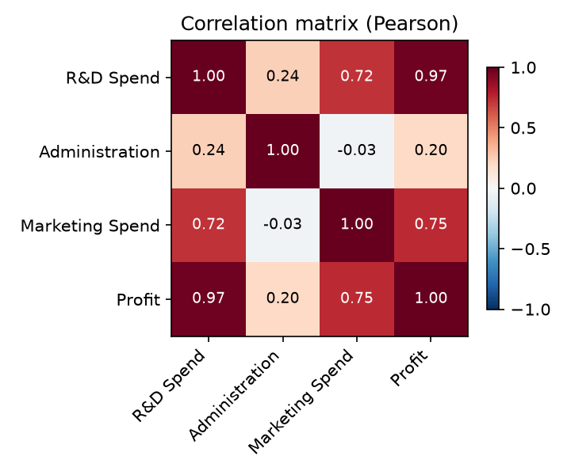
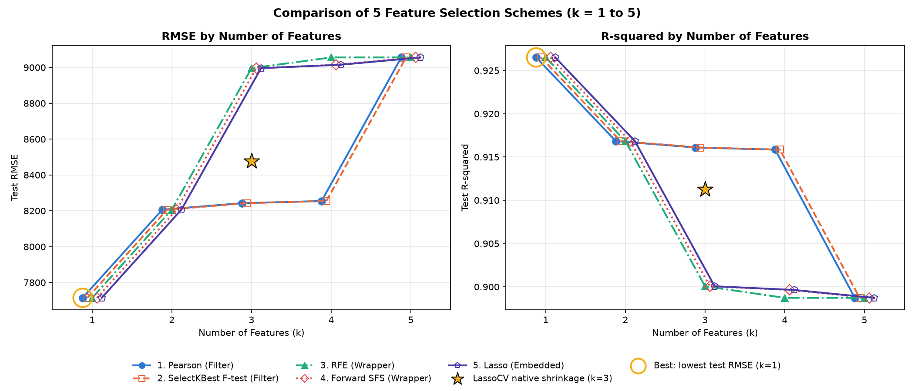
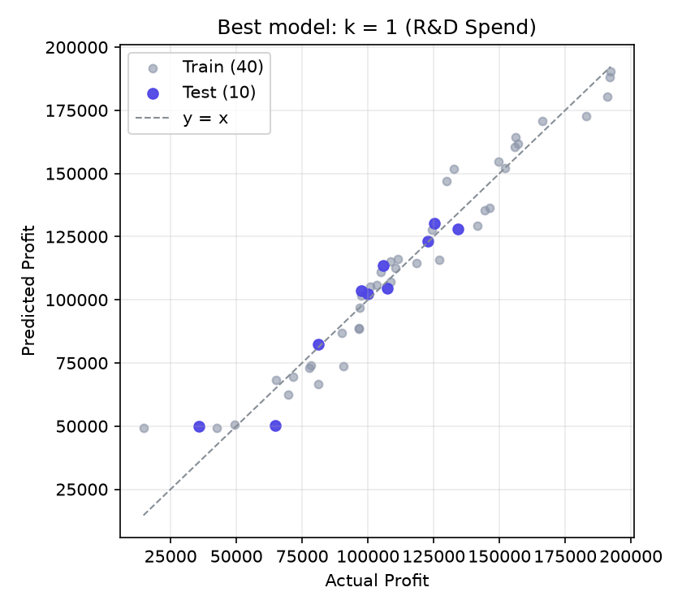
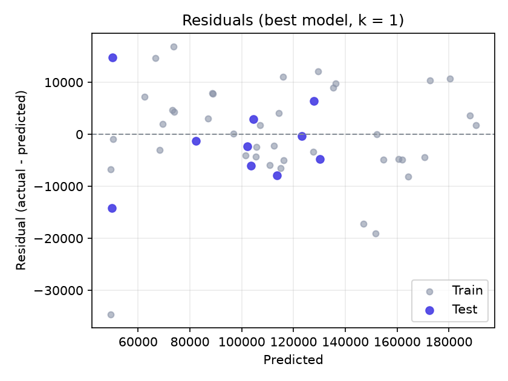

# Problem 1 — 50 Startups：CRISP-DM × 5 種特徵選擇方法報告

> 由 `mlr-crisp-dm` skill 產生 · 資料來源：<https://raw.githubusercontent.com/Avik-Jain/100-Days-Of-ML-Code/master/datasets/50_Startups.csv> · 2026-10-14 23:49

## 1. Business Understanding 商業理解

創投公司想知道新創公司的支出結構與所在州別如何影響年度利潤：研發（R&D Spend）、行政（Administration）、行銷（Marketing Spend）支出以及所在州（State），哪些因素真正影響利潤（Profit）？以多元線性回歸建立利潤預測模型，並比較 5 種特徵選擇方法在不同特徵數 k 下的表現，找出最精簡且準確的特徵組合，作為投資判斷依據。

- 目標變數 y：`Profit`；候選特徵：`R&D Spend`, `Administration`, `Marketing Spend`, `State`
- 比較 5 種特徵選擇方法在 **k = 1 ~ 5** 的 Test RMSE（越低越好）與 Test R²（越高越好），表現相同時選特徵較少的模型。

## 2. Data Understanding 資料理解

資料共 **50 筆 × 5 欄**，缺失值 0 個。

| 欄位 | 型態 | 缺失 | 唯一值 | 備註 |
|---|---|---|---|---|
| R&D Spend | 數值 | 0 | 49 |  |
| Administration | 數值 | 0 | 50 |  |
| Marketing Spend | 數值 | 0 | 48 |  |
| State | 類別 | 0 | 3 |  |
| Profit | 數值 | 0 | 50 | 目標 y |

**敘述統計**

| 欄位 | count | mean | std | min | 25% | 50% | 75% | max |
|---|---|---|---|---|---|---|---|---|
| R&D Spend | 50 | 73,722 | 45,902 | 0 | 39,936 | 73,051 | 101,603 | 165,349 |
| Administration | 50 | 121,345 | 28,018 | 51,283 | 103,731 | 122,700 | 144,842 | 182,646 |
| Marketing Spend | 50 | 211,025 | 122,290 | 0 | 129,300 | 212,716 | 299,469 | 471,784 |
| Profit | 50 | 112,013 | 40,306 | 14,681 | 90,139 | 107,978 | 139,766 | 192,262 |

**State 類別分布**：California 17 筆、Florida 16 筆、New York 17 筆

**訓練集單變數統計（兩種 Filter 方法的依據）**

| 特徵 | Pearson r | F（f_regression） | p 值 |
|---|---|---|---|
| `R&D Spend` | +0.9730 | 676.10 | 8.22e-26 |
| `Marketing Spend` | +0.7738 | 56.691 | 4.78e-09 |
| `State_New York` | +0.1050 | 0.42385 | 0.5189 |
| `State_Florida` | +0.0955 | 0.34969 | 0.5578 |
| `Administration` | +0.0902 | 0.31195 | 0.5798 |

F = (n − 2)·r² / (1 − r²) 是 |r| 的單調函數，所以 Pearson 與 SelectKBest 的排序完全相同，兩條線重疊是正確結果。

## 3. Data Preparation 資料準備

- 缺失值：無缺失值，不需處理
- One-hot（drop_first）：`State` → `State_Florida`, `State_New York`（基準類別 `California`，避免 dummy variable trap）
- 切分：`train_test_split(test_size=0.2, random_state=42)` → 訓練 40 筆、測試 10 筆（網頁以 numpy MT19937 重現同一個排列，逐筆相同）
- 標準化：`StandardScaler` 只用訓練集 fit，供 RFE 與 Lasso 比較係數大小；選出的特徵一律用 OLS 在原始單位重新配適
- 交叉驗證：`KFold(n_splits=5, shuffle=True, random_state=42)`，供 Forward SFS、LassoCV 與 CV RMSE 共用

## 4. Modeling 建模

### 4.1 五種特徵選擇方法

| # | 方法 | 類型 | 規則 | 特徵排序（前 k 個 = 選 k 個特徵） |
|---|---|---|---|---|
| 1 | Pearson | Filter | 訓練集 \|Pearson r(x, y)\| 由大到小，取前 k 個 | R&D Spend › Marketing Spend › State_New York › State_Florida › Administration |
| 2 | SelectKBest F-test | Filter | `SelectKBest(f_regression)`：F = (n−2)·r²/(1−r²) 最大的 k 個（與 Pearson 排序相同） | R&D Spend › Marketing Spend › State_New York › State_Florida › Administration |
| 3 | RFE | Wrapper | `RFE(LinearRegression)` 於標準化特徵，每輪移除 \|係數\| 最小的特徵 | R&D Spend › Marketing Spend › Administration › State_Florida › State_New York |
| 4 | Forward SFS | Wrapper | `SequentialFeatureSelector(forward, cv=KFold(5, shuffle=True))`，每步加入 CV 平均 R² 最高者 | R&D Spend › Marketing Spend › Administration › State_New York › State_Florida |
| 5 | Lasso | Embedded | `LassoCV(cv=KFold(5, shuffle=True))` 收縮後的 \|係數\| 由大到小（係數為 0 者排最後） | R&D Spend › Marketing Spend › Administration › State_New York › State_Florida |

LassoCV 以 5 折 CV 選出 α = 657.954，保留 3 個非 0 係數：`R&D Spend`, `Administration`, `Marketing Spend`。

### 4.2 全特徵模型（OLS，訓練集）

`Profit = 54,028 + 0.80563 × R&D Spend − 0.068788 × Administration + 0.029855 × Marketing Spend + 938.79 × State_Florida + 6.9878 × State_New York`

| 變數 | 係數 | 標準誤 | t | p 值 | 95% 信賴區間 | VIF |
|---|---|---|---|---|---|---|
| (Intercept) | 54,028 | 8,457.3 | 6.388 | 2.71e-07 *** | [36,841, 71,215] | — |
| **R&D Spend** | 0.80563 | 0.052371 | 15.383 | 7.00e-17 *** | [0.69920, 0.91206] | 2.617 |
| Administration | -0.068788 | 0.060737 | -1.133 | 0.2653 | [-0.19222, 0.054645] | 1.157 |
| Marketing Spend | 0.029855 | 0.022177 | 1.346 | 0.1871 | [-0.015213, 0.074924] | 2.699 |
| State_Florida | 938.79 | 3,893.5 | 0.241 | 0.8109 | [-6,973.8, 8,851.4] | 1.471 |
| State_New York | 6.9878 | 3,882.8 | 0.002 | 0.9986 | [-7,883.7, 7,897.7] | 1.411 |

R² = **0.9537**、Adj R² = **0.9469**、F = 140.07（p = 1.13e-21）、殘差標準誤 σ = 9,683.2；粗體 = p < 0.05（*** p<0.001、** p<0.01、* p<0.05、. p<0.1）

## 5. Evaluation 評估

**Test RMSE**（粗體 = 最佳組合）

| k | Pearson | SelectKBest F-test | RFE | Forward SFS | Lasso |
|---|---|---|---|---|---|
| 1 | **7,714.33** | **7,714.33** | **7,714.33** | **7,714.33** | **7,714.33** |
| 2 | 8,206.33 | 8,206.33 | 8,206.33 | 8,206.33 | 8,206.33 |
| 3 | 8,242.78 | 8,242.78 | 8,995.91 | 8,995.91 | 8,995.91 |
| 4 | 8,254.69 | 8,254.69 | 9,055.96 | 9,015.11 | 9,015.11 |
| 5 | 9,055.96 | 9,055.96 | 9,055.96 | 9,055.96 | 9,055.96 |

**Test R²**（粗體 = 最佳組合）

| k | Pearson | SelectKBest F-test | RFE | Forward SFS | Lasso |
|---|---|---|---|---|---|
| 1 | **0.9265** | **0.9265** | **0.9265** | **0.9265** | **0.9265** |
| 2 | 0.9168 | 0.9168 | 0.9168 | 0.9168 | 0.9168 |
| 3 | 0.9161 | 0.9161 | 0.9001 | 0.9001 | 0.9001 |
| 4 | 0.9159 | 0.9159 | 0.8987 | 0.8996 | 0.8996 |
| 5 | 0.8987 | 0.8987 | 0.8987 | 0.8987 | 0.8987 |

**每個 k 新增的特徵**（前 k 列累積起來就是選出的 k 個特徵）

| k | Pearson | SelectKBest F-test | RFE | Forward SFS | Lasso |
|---|---|---|---|---|---|
| 1 | +R&D Spend | +R&D Spend | +R&D Spend | +R&D Spend | +R&D Spend |
| 2 | +Marketing Spend | +Marketing Spend | +Marketing Spend | +Marketing Spend | +Marketing Spend |
| 3 | +State_New York | +State_New York | +Administration | +Administration | +Administration |
| 4 | +State_Florida | +State_Florida | +State_Florida | +State_New York | +State_New York |
| 5 | +Administration | +Administration | +State_New York | +State_Florida | +State_Florida |

**5-fold CV RMSE（訓練集內）**

| k | Pearson | SelectKBest F-test | RFE | Forward SFS | Lasso |
|---|---|---|---|---|---|
| 1 | 9,406.58 | 9,406.58 | 9,406.58 | 9,406.58 | 9,406.58 |
| 2 | 9,186.68 | 9,186.68 | 9,186.68 | 9,186.68 | 9,186.68 |
| 3 | 9,460.92 | 9,460.92 | 9,104.68 | 9,104.68 | 9,104.68 |
| 4 | 9,655.47 | 9,655.47 | 9,299.00 | 9,303.46 | 9,303.46 |
| 5 | 9,550.68 | 9,550.68 | 9,550.68 | 9,550.68 | 9,550.68 |

**結論**

- 最佳組合（Test RMSE 最低）：**k = 1**，`R&D Spend`，Test RMSE = **7,714.33**、R² = **0.9265**（選出這組特徵的方法：Pearson、SelectKBest F-test、RFE、Forward SFS、Lasso）。
- 全特徵模型（k = 5）：Test RMSE 9,055.96、R² 0.8987 → 最佳組合的 RMSE 降低 14.8%。
- LassoCV 原生收縮模型（★，k = 3）：Test RMSE 8,477.43、R² 0.9113。
- 以訓練集 5-fold CV 評估時，RMSE 最低在 k = 3（RFE、Forward SFS、Lasso，9,104.68）；測試集只有 10 筆，選 k 時宜同時參考 CV。
- 共線性：所有特徵 VIF < 10，共線性不嚴重。

**最佳模型（k = 1）**：`Profit = 49,337 + 0.85361 × R&D Spend`

| 變數 | 係數 | 標準誤 | t | p 值 | 95% 信賴區間 |
|---|---|---|---|---|---|
| (Intercept) | 49,337 | 2,985.8 | 16.524 | 6.15e-19 *** | [43,292, 55,381] |
| **R&D Spend** | 0.85361 | 0.032829 | 26.002 | 8.22e-26 *** | [0.78715, 0.92007] |

## 6. Deployment 部署

- [互動式網頁（GitHub Pages）](https://jua91352.github.io/AIoT-DIC2-MultipleLR/?problem=startups)：下拉選單切換 Problem、可輸入任意 CSV 網址；同樣的切分與參數會得到與本報告相同的數字，並可在「模型檢視」用滑桿即時預測。
- 最佳模型：`Profit = 49,337 + 0.85361 × R&D Spend`
