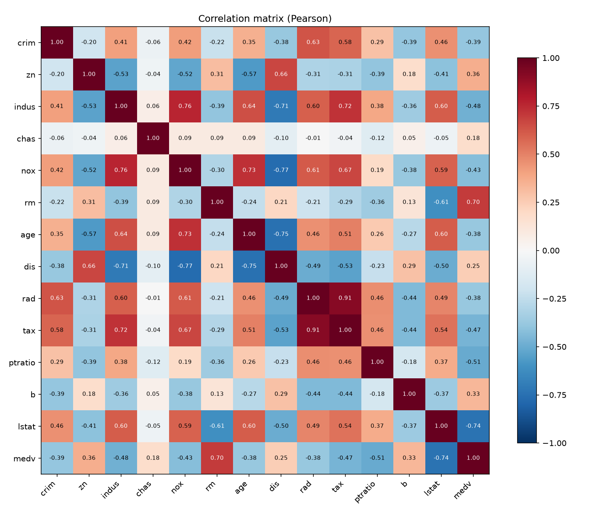
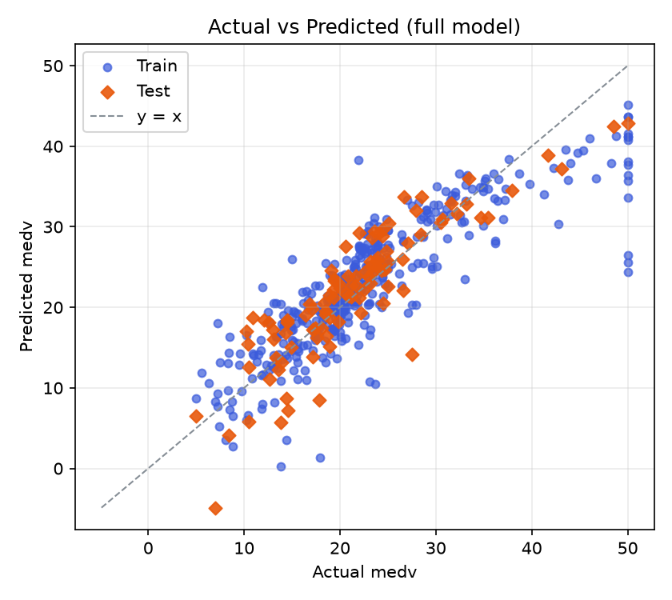
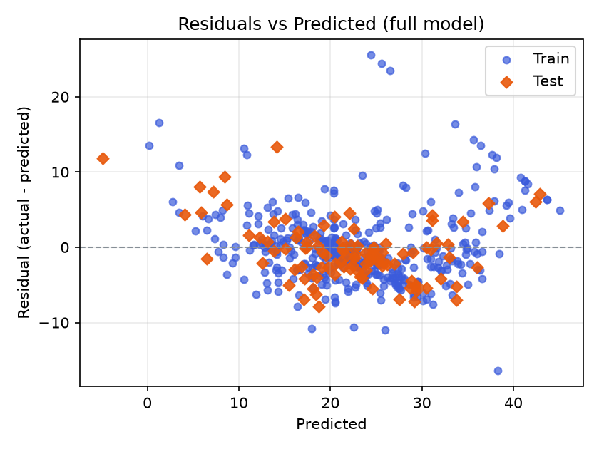
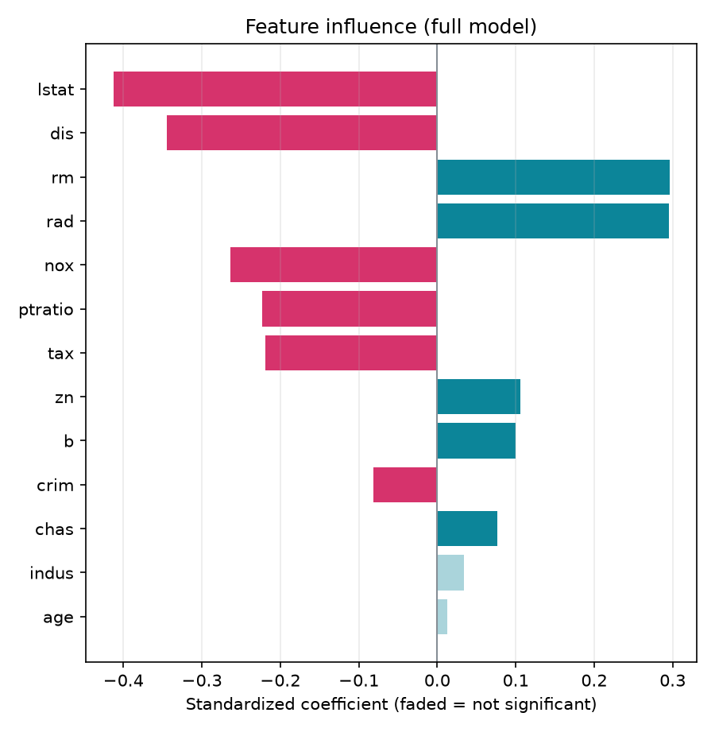
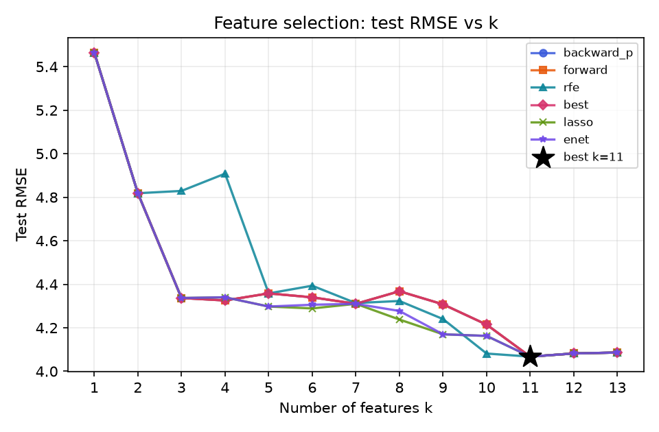

# Problem 2 — Boston Housing：多元線性回歸分析報告（CRISP-DM）

> 由 `mlr-crisp-dm` skill 產生 · 資料來源：<https://raw.githubusercontent.com/selva86/datasets/master/BostonHousing.csv> · 2026-10-14 20:26

## 1. Business Understanding 商業理解

以 1970 年代波士頓地區 506 個普查區的 13 項特徵（犯罪率、平均房間數、低社經人口比例、師生比、空污濃度等）預測自住房屋價值中位數 medv（單位：千美元），找出影響房價的關鍵因素，作為不動產估價與都市規劃的參考。註：變數 `b` 由黑人人口比例計算而來，有倫理爭議（scikit-learn 1.2 起已移除此資料集），這裡沿用作業指定的經典資料集並保留原始欄位以便比較。

- 目標變數 y：`medv`
- 候選特徵 X：`crim`, `zn`, `indus`, `chas`, `nox`, `rm`, `age`, `dis`, `rad`, `tax`, `ptratio`, `b`, `lstat`

## 2. Data Understanding 資料理解

資料共 **506 筆 × 14 欄**，缺失值 0 個。

| 欄位 | 型態 | 缺失 | 唯一值 | 備註 |
|---|---|---|---|---|
| crim | 數值 | 0 | 504 |  |
| zn | 數值 | 0 | 26 |  |
| indus | 數值 | 0 | 76 |  |
| chas | 數值 | 0 | 2 |  |
| nox | 數值 | 0 | 81 |  |
| rm | 數值 | 0 | 446 |  |
| age | 數值 | 0 | 356 |  |
| dis | 數值 | 0 | 412 |  |
| rad | 數值 | 0 | 9 |  |
| tax | 數值 | 0 | 66 |  |
| ptratio | 數值 | 0 | 46 |  |
| b | 數值 | 0 | 357 |  |
| lstat | 數值 | 0 | 455 |  |
| medv | 數值 | 0 | 229 | 目標 y |

**敘述統計**

| 欄位 | count | mean | std | min | 25% | 50% | 75% | max |
|---|---|---|---|---|---|---|---|---|
| crim | 506 | 3.6135 | 8.6015 | 0.0063200 | 0.082045 | 0.25651 | 3.6771 | 88.976 |
| zn | 506 | 11.364 | 23.322 | 0 | 0 | 0 | 12.500 | 100.00 |
| indus | 506 | 11.137 | 6.8604 | 0.46000 | 5.1900 | 9.6900 | 18.100 | 27.740 |
| chas | 506 | 0.069170 | 0.25399 | 0 | 0 | 0 | 0 | 1.0000 |
| nox | 506 | 0.55470 | 0.11588 | 0.38500 | 0.44900 | 0.53800 | 0.62400 | 0.87100 |
| rm | 506 | 6.2846 | 0.70262 | 3.5610 | 5.8855 | 6.2085 | 6.6235 | 8.7800 |
| age | 506 | 68.575 | 28.149 | 2.9000 | 45.025 | 77.500 | 94.075 | 100.00 |
| dis | 506 | 3.7950 | 2.1057 | 1.1296 | 2.1002 | 3.2074 | 5.1884 | 12.127 |
| rad | 506 | 9.5494 | 8.7073 | 1.0000 | 4.0000 | 5.0000 | 24.000 | 24.000 |
| tax | 506 | 408.24 | 168.54 | 187.00 | 279.00 | 330.00 | 666.00 | 711.00 |
| ptratio | 506 | 18.456 | 2.1649 | 12.600 | 17.400 | 19.050 | 20.200 | 22.000 |
| b | 506 | 356.67 | 91.295 | 0.32000 | 375.38 | 391.44 | 396.23 | 396.90 |
| lstat | 506 | 12.653 | 7.1411 | 1.7300 | 6.9500 | 11.360 | 16.955 | 37.970 |
| medv | 506 | 22.533 | 9.1971 | 5.0000 | 17.025 | 21.200 | 25.000 | 50.000 |

**與目標的相關係數（依絕對值排序）**：`lstat` -0.738、`rm` +0.695、`ptratio` -0.508、`indus` -0.484、`tax` -0.469、`nox` -0.427、`crim` -0.388、`rad` -0.382、`age` -0.377、`zn` +0.360、`b` +0.333、`dis` +0.250、`chas` +0.175

## 3. Data Preparation 資料準備

- 缺失值：無缺失值，不需處理
- 訓練/測試切分：訓練 405 筆、測試 101 筆（test ratio 0.2、seed 42，mulberry32 洗牌，與網頁版相同）
- 模型直接使用原始單位（不標準化），另以標準化係數比較各特徵影響力

## 4. Modeling 建模

### 4.1 全特徵模型（OLS）

`medv = 37.403 − 0.099622 × crim + 0.043643 × zn + 0.045653 × indus + 2.7527 × chas − 21.519 × nox + 3.9807 × rm + 0.0042547 × age − 1.5485 × dis + 0.31751 × rad − 0.012094 × tax − 0.96232 × ptratio + 0.010053 × b − 0.55426 × lstat`

| 變數 | 係數 | 標準誤 | t | p 值 | 95% 信賴區間 | VIF | 標準化係數 |
|---|---|---|---|---|---|---|---|
| (Intercept) | 37.403 | 5.9647 | 6.271 | 9.52e-10 *** | [25.676, 49.130] | — | — |
| **crim** | -0.099622 | 0.044212 | -2.253 | 0.0248 * | [-0.18655, -0.012698] | 1.962 | -0.082 |
| **zn** | 0.043643 | 0.016665 | 2.619 | 0.0092 ** | [0.010879, 0.076406] | 2.447 | 0.106 |
| indus | 0.045653 | 0.070509 | 0.647 | 0.5177 | [-0.092971, 0.18428] | 4.043 | 0.034 |
| **chas** | 2.7527 | 0.96840 | 2.842 | 0.0047 ** | [0.84874, 4.6566] | 1.076 | 0.076 |
| **nox** | -21.519 | 4.3880 | -4.904 | 1.38e-06 *** | [-30.146, -12.892] | 4.298 | -0.263 |
| **rm** | 3.9807 | 0.48899 | 8.141 | 5.31e-15 *** | [3.0194, 4.9421] | 1.965 | 0.296 |
| age | 0.0042547 | 0.015284 | 0.278 | 0.7809 | [-0.025795, 0.034304] | 3.062 | 0.013 |
| **dis** | -1.5485 | 0.23165 | -6.685 | 7.99e-11 *** | [-2.0040, -1.0931] | 3.965 | -0.345 |
| **rad** | 0.31751 | 0.075906 | 4.183 | 3.56e-05 *** | [0.16827, 0.46674] | 7.404 | 0.295 |
| **tax** | -0.012094 | 0.0042562 | -2.841 | 0.0047 ** | [-0.020462, -0.0037260] | 8.838 | -0.219 |
| **ptratio** | -0.96232 | 0.15289 | -6.294 | 8.30e-10 *** | [-1.2629, -0.66173] | 1.869 | -0.223 |
| **b** | 0.010053 | 0.0030882 | 3.255 | 0.0012 ** | [0.0039812, 0.016124] | 1.400 | 0.100 |
| **lstat** | -0.55426 | 0.059637 | -9.294 | 1.06e-18 *** | [-0.67151, -0.43701] | 2.939 | -0.413 |

R² = **0.7374**、Adj R² = **0.7287**、F = 84.464（p = 8.43e-105）、殘差標準誤 σ = 4.9195、AIC = 2,453.6、BIC = 2,509.6；顯著標記：*** p<0.001、** p<0.01、* p<0.05、. p<0.1

### 4.2 逆向淘汰（Backward Elimination，SL = 0.05）

| 步驟 | 移除變數 | p 值 | 移除前 R² | 移除前 Adj R² |
|---|---|---|---|---|
| 1 | `age` | 0.7809 | 0.7374 | 0.7287 |
| 2 | `indus` | 0.5179 | 0.7374 | 0.7293 |

保留特徵：`crim`, `zn`, `chas`, `nox`, `rm`, `dis`, `rad`, `tax`, `ptratio`, `b`, `lstat`

`medv = 37.003 − 0.10041 × crim + 0.042008 × zn + 2.8370 × chas − 20.468 × nox + 3.9794 × rm − 1.5982 × dis + 0.30130 × rad − 0.010813 × tax − 0.94414 × ptratio + 0.010074 × b − 0.54455 × lstat`

| 變數 | 係數 | 標準誤 | t | p 值 | 95% 信賴區間 |
|---|---|---|---|---|---|
| (Intercept) | 37.003 | 5.9149 | 6.256 | 1.03e-09 *** | [25.375, 48.632] |
| **crim** | -0.10041 | 0.044056 | -2.279 | 0.0232 * | [-0.18703, -0.013797] |
| **zn** | 0.042008 | 0.016424 | 2.558 | 0.0109 * | [0.0097192, 0.074297] |
| **chas** | 2.8370 | 0.95904 | 2.958 | 0.0033 ** | [0.95156, 4.7225] |
| **nox** | -20.468 | 4.0692 | -5.030 | 7.48e-07 *** | [-28.468, -12.468] |
| **rm** | 3.9794 | 0.47560 | 8.367 | 1.04e-15 *** | [3.0444, 4.9144] |
| **dis** | -1.5982 | 0.21696 | -7.366 | 1.04e-12 *** | [-2.0247, -1.1716] |
| **rad** | 0.30130 | 0.072173 | 4.175 | 3.68e-05 *** | [0.15941, 0.44320] |
| **tax** | -0.010813 | 0.0038076 | -2.840 | 0.0047 ** | [-0.018299, -0.0033275] |
| **ptratio** | -0.94414 | 0.15040 | -6.277 | 9.11e-10 *** | [-1.2398, -0.64845] |
| **b** | 0.010074 | 0.0030698 | 3.282 | 0.0011 ** | [0.0040384, 0.016109] |
| **lstat** | -0.54455 | 0.055688 | -9.779 | 2.34e-20 *** | [-0.65403, -0.43507] |

## 5. Evaluation 評估

| 模型 | 特徵數 | Train R² | Train Adj R² | Test R² | Test RMSE | Test MAE |
|---|---|---|---|---|---|---|
| 全特徵模型 | 13 | 0.7374 | 0.7287 | 0.7435 | 4.0863 | 3.1404 |
| 逆向淘汰模型（SL = 0.05） | 11 | 0.7371 | 0.7297 | 0.7458 | 4.0674 | 3.1340 |
| 最佳 k 模型（k = 11） | 11 | 0.7371 | 0.7297 | 0.7458 | 4.0674 | 3.1340 |

### 5.1 特徵選擇比較（依特徵數 k）

六種方法各自決定「用 k 個特徵時選哪些」，每個組合都在訓練集用 OLS 配適、在測試集評估：

**Test RMSE**（粗體 = 最佳組合）

| k | 逆向淘汰（p 值） | 前向選擇 Forward | RFE（\|標準化係數\|） | 最佳子集 Exhaustive | Lasso（L1 排序） | ElasticNet（α = 0.5） |
|---|---|---|---|---|---|---|
| 1 | 5.4648 | 5.4648 | 5.4648 | 5.4648 | 5.4648 | 5.4648 |
| 2 | 4.8184 | 4.8184 | 4.8184 | 4.8184 | 4.8184 | 4.8184 |
| 3 | 4.3369 | 4.3369 | 4.8290 | 4.3369 | 4.3369 | 4.3369 |
| 4 | 4.3255 | 4.3255 | 4.9084 | 4.3255 | 4.3401 | 4.3401 |
| 5 | 4.3581 | 4.3581 | 4.3581 | 4.3581 | 4.2976 | 4.2976 |
| 6 | 4.3399 | 4.3399 | 4.3933 | 4.3399 | 4.2889 | 4.3058 |
| 7 | 4.3101 | 4.3101 | 4.3136 | 4.3101 | 4.3101 | 4.3101 |
| 8 | 4.3679 | 4.3679 | 4.3232 | 4.3679 | 4.2379 | 4.2772 |
| 9 | 4.3077 | 4.3077 | 4.2401 | 4.3077 | 4.1701 | 4.1701 |
| 10 | 4.2145 | 4.2145 | 4.0816 | 4.2145 | 4.1626 | 4.1626 |
| 11 | **4.0674** | **4.0674** | **4.0674** | **4.0674** | **4.0674** | **4.0674** |
| 12 | 4.0820 | 4.0820 | 4.0820 | 4.0820 | 4.0820 | 4.0820 |
| 13 | 4.0863 | 4.0863 | 4.0863 | 4.0863 | 4.0863 | 4.0863 |

**最佳子集 Exhaustive 每個 k 選出的特徵**

| k | 特徵 | Train Adj R² | Test R² | Test RMSE |
|---|---|---|---|---|
| 1 | `lstat` | 0.5411 | 0.5412 | 5.4648 |
| 2 | `rm`, `lstat` | 0.6340 | 0.6433 | 4.8184 |
| 3 | `rm`, `ptratio`, `lstat` | 0.6685 | 0.7111 | 4.3369 |
| 4 | `rm`, `dis`, `ptratio`, `lstat` | 0.6812 | 0.7126 | 4.3255 |
| 5 | `nox`, `rm`, `dis`, `ptratio`, `lstat` | 0.7021 | 0.7082 | 4.3581 |
| 6 | `nox`, `rm`, `dis`, `ptratio`, `b`, `lstat` | 0.7097 | 0.7107 | 4.3399 |
| 7 | `chas`, `nox`, `rm`, `dis`, `ptratio`, `b`, `lstat` | 0.7163 | 0.7146 | 4.3101 |
| 8 | `chas`, `nox`, `rm`, `dis`, `rad`, `ptratio`, `b`, `lstat` | 0.7209 | 0.7069 | 4.3679 |
| 9 | `chas`, `nox`, `rm`, `dis`, `rad`, `tax`, `ptratio`, `b`, `lstat` | 0.7238 | 0.7149 | 4.3077 |
| 10 | `zn`, `chas`, `nox`, `rm`, `dis`, `rad`, `tax`, `ptratio`, `b`, `lstat` | 0.7268 | 0.7271 | 4.2145 |
| 11 | `crim`, `zn`, `chas`, `nox`, `rm`, `dis`, `rad`, `tax`, `ptratio`, `b`, `lstat` | 0.7297 | 0.7458 | 4.0674 |
| 12 | `crim`, `zn`, `indus`, `chas`, `nox`, `rm`, `dis`, `rad`, `tax`, `ptratio`, `b`, `lstat` | 0.7293 | 0.7440 | 4.0820 |
| 13 | `crim`, `zn`, `indus`, `chas`, `nox`, `rm`, `age`, `dis`, `rad`, `tax`, `ptratio`, `b`, `lstat` | 0.7287 | 0.7435 | 4.0863 |

最佳組合（測試 RMSE 最低）：**k = 11**，特徵 `crim`, `zn`, `chas`, `nox`, `rm`, `dis`, `rad`, `tax`, `ptratio`, `b`, `lstat`，Test RMSE = 4.0674、Test R² = 0.7458（選出此組合的方法：逆向淘汰（p 值）、前向選擇 Forward、RFE（|標準化係數|）、最佳子集 Exhaustive、Lasso（L1 排序）、ElasticNet（α = 0.5））。

`medv = 37.003 − 0.10041 × crim + 0.042008 × zn + 2.8370 × chas − 20.468 × nox + 3.9794 × rm − 1.5982 × dis + 0.30130 × rad − 0.010813 × tax − 0.94414 × ptratio + 0.010074 × b − 0.54455 × lstat`

> 註：依作業範例以測試集比較 k；實務上建議用交叉驗證（cross-validation）選 k，避免對測試集過度調整。

**結論**

- 全特徵模型解釋了訓練資料 73.7% 的變異；測試集 R² = 0.7435、RMSE = 4.0863。
- 在 α = 0.05 下顯著的特徵：`crim`, `zn`, `chas`, `nox`, `rm`, `dis`, `rad`, `tax`, `ptratio`, `b`, `lstat`。
- 影響力最大（|標準化係數|）的特徵：`lstat`（負向，-0.413）、`dis`（負向，-0.345）、`rm`（正向，+0.296）。
- 逆向淘汰後保留 11 個特徵，測試集 R² 從 0.7435 變為 0.7458；以測試集 RMSE 來看逆向淘汰模型較佳。
- 特徵選擇比較：k = 11 時測試 RMSE 最低（4.0674，R² = 0.7458），特徵為 `crim`, `zn`, `chas`, `nox`, `rm`, `dis`, `rad`, `tax`, `ptratio`, `b`, `lstat`，比全特徵模型更精簡（13 → 11 個特徵）。
- 共線性：所有特徵 VIF < 10，共線性不嚴重。

## 6. Deployment 部署

- [互動式網頁（GitHub Pages）](https://jua91352.github.io/AIoT-DIC2-MultipleLR/?problem=boston)：下拉選單切換 Problem、可輸入任意 CSV 網址；同樣的切分與參數會得到與本報告相同的數字。
- 最佳 k 模型（k = 11）：`medv = 37.003 − 0.10041 × crim + 0.042008 × zn + 2.8370 × chas − 20.468 × nox + 3.9794 × rm − 1.5982 × dis + 0.30130 × rad − 0.010813 × tax − 0.94414 × ptratio + 0.010074 × b − 0.54455 × lstat`
- 逆向淘汰模型（SL = 0.05）：`medv = 37.003 − 0.10041 × crim + 0.042008 × zn + 2.8370 × chas − 20.468 × nox + 3.9794 × rm − 1.5982 × dis + 0.30130 × rad − 0.010813 × tax − 0.94414 × ptratio + 0.010074 × b − 0.54455 × lstat`
