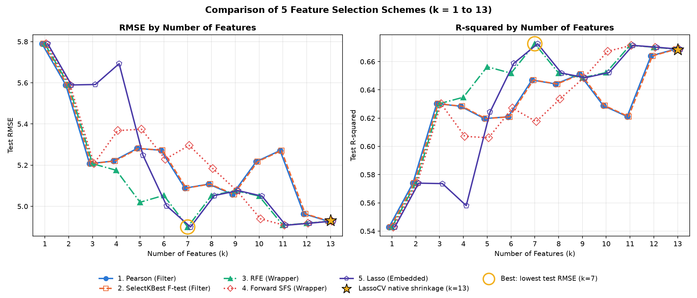

# Problem 2 — Boston Housing：CRISP-DM × 5 種特徵選擇方法報告

> 由 `mlr-crisp-dm` skill 產生 · 資料來源：<https://raw.githubusercontent.com/selva86/datasets/master/BostonHousing.csv> · 2026-10-14 23:49

## 1. Business Understanding 商業理解

以 1970 年代波士頓地區 506 個普查區的 13 項特徵（犯罪率、平均房間數、低社經人口比例、師生比、空污濃度等）預測自住房屋價值中位數 medv（單位：千美元），找出影響房價的關鍵因素，作為不動產估價與都市規劃的參考。註：變數 `b` 由黑人人口比例計算而來，有倫理爭議（scikit-learn 1.2 起已移除此資料集），這裡沿用作業指定的經典資料集並保留原始欄位以便比較。

- 目標變數 y：`medv`；候選特徵：`crim`, `zn`, `indus`, `chas`, `nox`, `rm`, `age`, `dis`, `rad`, `tax`, `ptratio`, `b`, `lstat`
- 比較 5 種特徵選擇方法在 **k = 1 ~ 13** 的 Test RMSE（越低越好）與 Test R²（越高越好），表現相同時選特徵較少的模型。

## 2. Data Understanding 資料理解

資料共 **506 筆 × 14 欄**，缺失值 0 個。

| 欄位 | 型態 | 缺失 | 唯一值 | 備註 |
|---|---|---|---|---|
| crim | 數值 | 0 | 504 |  |
| zn | 數值 | 0 | 26 |  |
| indus | 數值 | 0 | 76 |  |
| chas | 數值 | 0 | 2 |  |
| nox | 數值 | 0 | 81 |  |
| rm | 數值 | 0 | 446 |  |
| age | 數值 | 0 | 356 |  |
| dis | 數值 | 0 | 412 |  |
| rad | 數值 | 0 | 9 |  |
| tax | 數值 | 0 | 66 |  |
| ptratio | 數值 | 0 | 46 |  |
| b | 數值 | 0 | 357 |  |
| lstat | 數值 | 0 | 455 |  |
| medv | 數值 | 0 | 229 | 目標 y |

**敘述統計**

| 欄位 | count | mean | std | min | 25% | 50% | 75% | max |
|---|---|---|---|---|---|---|---|---|
| crim | 506 | 3.6135 | 8.6015 | 0.0063200 | 0.082045 | 0.25651 | 3.6771 | 88.976 |
| zn | 506 | 11.364 | 23.322 | 0 | 0 | 0 | 12.500 | 100.00 |
| indus | 506 | 11.137 | 6.8604 | 0.46000 | 5.1900 | 9.6900 | 18.100 | 27.740 |
| chas | 506 | 0.069170 | 0.25399 | 0 | 0 | 0 | 0 | 1.0000 |
| nox | 506 | 0.55470 | 0.11588 | 0.38500 | 0.44900 | 0.53800 | 0.62400 | 0.87100 |
| rm | 506 | 6.2846 | 0.70262 | 3.5610 | 5.8855 | 6.2085 | 6.6235 | 8.7800 |
| age | 506 | 68.575 | 28.149 | 2.9000 | 45.025 | 77.500 | 94.075 | 100.00 |
| dis | 506 | 3.7950 | 2.1057 | 1.1296 | 2.1002 | 3.2074 | 5.1884 | 12.127 |
| rad | 506 | 9.5494 | 8.7073 | 1.0000 | 4.0000 | 5.0000 | 24.000 | 24.000 |
| tax | 506 | 408.24 | 168.54 | 187.00 | 279.00 | 330.00 | 666.00 | 711.00 |
| ptratio | 506 | 18.456 | 2.1649 | 12.600 | 17.400 | 19.050 | 20.200 | 22.000 |
| b | 506 | 356.67 | 91.295 | 0.32000 | 375.38 | 391.44 | 396.23 | 396.90 |
| lstat | 506 | 12.653 | 7.1411 | 1.7300 | 6.9500 | 11.360 | 16.955 | 37.970 |
| medv | 506 | 22.533 | 9.1971 | 5.0000 | 17.025 | 21.200 | 25.000 | 50.000 |

**訓練集單變數統計（兩種 Filter 方法的依據）**

| 特徵 | Pearson r | F（f_regression） | p 值 |
|---|---|---|---|
| `lstat` | -0.7364 | 476.34 | 3.20e-70 |
| `rm` | +0.7107 | 410.23 | 2.24e-63 |
| `ptratio` | -0.4912 | 127.84 | 6.32e-26 |
| `indus` | -0.4705 | 114.32 | 1.19e-23 |
| `tax` | -0.4598 | 107.77 | 1.59e-22 |
| `nox` | -0.4158 | 84.014 | 2.56e-18 |
| `rad` | -0.3875 | 71.014 | 6.39e-16 |
| `crim` | -0.3801 | 67.884 | 2.47e-15 |
| `age` | -0.3402 | 52.621 | 2.10e-12 |
| `b` | +0.3399 | 52.517 | 2.20e-12 |
| `zn` | +0.3095 | 42.588 | 2.04e-10 |
| `dis` | +0.2351 | 23.522 | 1.77e-06 |
| `chas` | +0.1906 | 15.161 | 0.0001 |

F = (n − 2)·r² / (1 − r²) 是 |r| 的單調函數，所以 Pearson 與 SelectKBest 的排序完全相同，兩條線重疊是正確結果。

## 3. Data Preparation 資料準備

- 缺失值：無缺失值，不需處理
- 切分：`train_test_split(test_size=0.2, random_state=42)` → 訓練 404 筆、測試 102 筆（網頁以 numpy MT19937 重現同一個排列，逐筆相同）
- 標準化：`StandardScaler` 只用訓練集 fit，供 RFE 與 Lasso 比較係數大小；選出的特徵一律用 OLS 在原始單位重新配適
- 交叉驗證：`KFold(n_splits=5, shuffle=True, random_state=42)`，供 Forward SFS、LassoCV 與 CV RMSE 共用

## 4. Modeling 建模

### 4.1 五種特徵選擇方法

| # | 方法 | 類型 | 規則 | 特徵排序（前 k 個 = 選 k 個特徵） |
|---|---|---|---|---|
| 1 | Pearson | Filter | 訓練集 \|Pearson r(x, y)\| 由大到小，取前 k 個 | lstat › rm › ptratio › indus › tax › nox › rad › crim › age › b › zn › dis › chas |
| 2 | SelectKBest F-test | Filter | `SelectKBest(f_regression)`：F = (n−2)·r²/(1−r²) 最大的 k 個（與 Pearson 排序相同） | lstat › rm › ptratio › indus › tax › nox › rad › crim › age › b › zn › dis › chas |
| 3 | RFE | Wrapper | `RFE(LinearRegression)` 於標準化特徵，每輪移除 \|係數\| 最小的特徵 | lstat › rm › ptratio › dis › nox › tax › rad › b › crim › chas › zn › indus › age |
| 4 | Forward SFS | Wrapper | `SequentialFeatureSelector(forward, cv=KFold(5, shuffle=True))`，每步加入 CV 平均 R² 最高者 | lstat › rm › ptratio › b › dis › nox › crim › rad › tax › zn › chas › age › indus |
| 5 | Lasso | Embedded | `LassoCV(cv=KFold(5, shuffle=True))` 收縮後的 \|係數\| 由大到小（係數為 0 者排最後） | lstat › rm › dis › rad › ptratio › nox › tax › b › crim › chas › zn › indus › age |

LassoCV 以 5 折 CV 選出 α = 0.00686389，保留 13 個非 0 係數：`crim`, `zn`, `indus`, `chas`, `nox`, `rm`, `age`, `dis`, `rad`, `tax`, `ptratio`, `b`, `lstat`。

### 4.2 全特徵模型（OLS，訓練集）

`medv = 30.247 − 0.11306 × crim + 0.030110 × zn + 0.040381 × indus + 2.7844 × chas − 17.203 × nox + 4.4388 × rm − 0.0062964 × age − 1.4479 × dis + 0.26243 × rad − 0.010647 × tax − 0.91546 × ptratio + 0.012351 × b − 0.50857 × lstat`

| 變數 | 係數 | 標準誤 | t | p 值 | 95% 信賴區間 | VIF |
|---|---|---|---|---|---|---|
| (Intercept) | 30.247 | 5.6768 | 5.328 | 1.68e-07 *** | [19.086, 41.408] | — |
| **crim** | -0.11306 | 0.034784 | -3.250 | 0.0013 ** | [-0.18144, -0.044668] | 1.713 |
| zn | 0.030110 | 0.015996 | 1.882 | 0.0605 . | [-0.0013390, 0.061560] | 2.466 |
| indus | 0.040381 | 0.067365 | 0.599 | 0.5492 | [-0.092063, 0.17282] | 3.878 |
| **chas** | 2.7844 | 0.95569 | 2.914 | 0.0038 ** | [0.90549, 4.6634] | 1.097 |
| **nox** | -17.203 | 4.2361 | -4.061 | 5.91e-05 *** | [-25.531, -8.8741] | 4.469 |
| **rm** | 4.4388 | 0.46398 | 9.567 | 1.29e-19 *** | [3.5266, 5.3510] | 1.948 |
| age | -0.0062964 | 0.014568 | -0.432 | 0.6658 | [-0.034938, 0.022345] | 2.990 |
| **dis** | -1.4479 | 0.22595 | -6.408 | 4.26e-10 *** | [-1.8921, -1.0036] | 4.169 |
| **rad** | 0.26243 | 0.075986 | 3.454 | 0.0006 *** | [0.11304, 0.41182] | 7.658 |
| **tax** | -0.010647 | 0.0042446 | -2.508 | 0.0125 * | [-0.018992, -0.0023016] | 8.943 |
| **ptratio** | -0.91546 | 0.14400 | -6.357 | 5.74e-10 *** | [-1.1986, -0.63235] | 1.851 |
| **b** | 0.012351 | 0.0029651 | 4.166 | 3.83e-05 *** | [0.0065217, 0.018181] | 1.325 |
| **lstat** | -0.50857 | 0.055684 | -9.133 | 3.66e-18 *** | [-0.61805, -0.39909] | 2.818 |

R² = **0.7509**、Adj R² = **0.7426**、F = 90.427（p = 6.21e-109）、殘差標準誤 σ = 4.7348；粗體 = p < 0.05（*** p<0.001、** p<0.01、* p<0.05、. p<0.1）

## 5. Evaluation 評估

**Test RMSE**（粗體 = 最佳組合）

| k | Pearson | SelectKBest F-test | RFE | Forward SFS | Lasso |
|---|---|---|---|---|---|
| 1 | 5.7896 | 5.7896 | 5.7896 | 5.7896 | 5.7896 |
| 2 | 5.5896 | 5.5896 | 5.5896 | 5.5896 | 5.5896 |
| 3 | 5.2072 | 5.2072 | 5.2072 | 5.2072 | 5.5916 |
| 4 | 5.2201 | 5.2201 | 5.1751 | 5.3678 | 5.6929 |
| 5 | 5.2812 | 5.2812 | 5.0197 | 5.3745 | 5.2485 |
| 6 | 5.2723 | 5.2723 | 5.0531 | 5.2290 | 5.0020 |
| 7 | 5.0881 | 5.0881 | **4.8995** | 5.2962 | **4.8995** |
| 8 | 5.1080 | 5.1080 | 5.0523 | 5.1833 | 5.0523 |
| 9 | 5.0582 | 5.0582 | 5.0763 | 5.0763 | 5.0763 |
| 10 | 5.2173 | 5.2173 | 5.0498 | 4.9392 | 5.0498 |
| 11 | 5.2710 | 5.2710 | 4.9080 | 4.9080 | 4.9080 |
| 12 | 4.9634 | 4.9634 | 4.9177 | 4.9179 | 4.9177 |
| 13 | 4.9286 | 4.9286 | 4.9286 | 4.9286 | 4.9286 |

**Test R²**（粗體 = 最佳組合）

| k | Pearson | SelectKBest F-test | RFE | Forward SFS | Lasso |
|---|---|---|---|---|---|
| 1 | 0.5429 | 0.5429 | 0.5429 | 0.5429 | 0.5429 |
| 2 | 0.5740 | 0.5740 | 0.5740 | 0.5740 | 0.5740 |
| 3 | 0.6303 | 0.6303 | 0.6303 | 0.6303 | 0.5736 |
| 4 | 0.6284 | 0.6284 | 0.6348 | 0.6071 | 0.5581 |
| 5 | 0.6197 | 0.6197 | 0.6564 | 0.6061 | 0.6244 |
| 6 | 0.6210 | 0.6210 | 0.6518 | 0.6272 | 0.6588 |
| 7 | 0.6470 | 0.6470 | **0.6727** | 0.6175 | **0.6727** |
| 8 | 0.6442 | 0.6442 | 0.6519 | 0.6336 | 0.6519 |
| 9 | 0.6511 | 0.6511 | 0.6486 | 0.6486 | 0.6486 |
| 10 | 0.6288 | 0.6288 | 0.6523 | 0.6673 | 0.6523 |
| 11 | 0.6211 | 0.6211 | 0.6715 | 0.6715 | 0.6715 |
| 12 | 0.6641 | 0.6641 | 0.6702 | 0.6702 | 0.6702 |
| 13 | 0.6688 | 0.6688 | 0.6688 | 0.6688 | 0.6688 |

**每個 k 新增的特徵**（前 k 列累積起來就是選出的 k 個特徵）

| k | Pearson | SelectKBest F-test | RFE | Forward SFS | Lasso |
|---|---|---|---|---|---|
| 1 | +lstat | +lstat | +lstat | +lstat | +lstat |
| 2 | +rm | +rm | +rm | +rm | +rm |
| 3 | +ptratio | +ptratio | +ptratio | +ptratio | +dis |
| 4 | +indus | +indus | +dis | +b | +rad |
| 5 | +tax | +tax | +nox | +dis | +ptratio |
| 6 | +nox | +nox | +tax | +nox | +nox |
| 7 | +rad | +rad | +rad | +crim | +tax |
| 8 | +crim | +crim | +b | +rad | +b |
| 9 | +age | +age | +crim | +tax | +crim |
| 10 | +b | +b | +chas | +zn | +chas |
| 11 | +zn | +zn | +zn | +chas | +zn |
| 12 | +dis | +dis | +indus | +age | +indus |
| 13 | +chas | +chas | +age | +indus | +age |

**5-fold CV RMSE（訓練集內）**

| k | Pearson | SelectKBest F-test | RFE | Forward SFS | Lasso |
|---|---|---|---|---|---|
| 1 | 6.2696 | 6.2696 | 6.2696 | 6.2696 | 6.2696 |
| 2 | 5.5531 | 5.5531 | 5.5531 | 5.5531 | 5.5531 |
| 3 | 5.2739 | 5.2739 | 5.2739 | 5.2739 | 5.4849 |
| 4 | 5.2863 | 5.2863 | 5.1705 | 5.1425 | 5.4147 |
| 5 | 5.2957 | 5.2957 | 5.0421 | 4.9995 | 5.2064 |
| 6 | 5.2948 | 5.2948 | 5.0666 | 4.9121 | 5.0979 |
| 7 | 5.2964 | 5.2964 | 5.0731 | 4.8776 | 5.0731 |
| 8 | 5.2264 | 5.2264 | 4.9356 | 4.8682 | 4.9356 |
| 9 | 5.2086 | 5.2086 | 4.8540 | 4.8540 | 4.8540 |
| 10 | 5.0870 | 5.0870 | 4.8657 | 4.8416 | 4.8657 |
| 11 | 5.1014 | 5.1014 | 4.8548 | 4.8548 | 4.8548 |
| 12 | 4.8451 | 4.8451 | 4.8643 | 4.8573 | 4.8643 |
| 13 | 4.8663 | 4.8663 | 4.8663 | 4.8663 | 4.8663 |

**結論**

- 最佳組合（Test RMSE 最低）：**k = 7**，`lstat`, `rm`, `ptratio`, `dis`, `nox`, `tax`, `rad`，Test RMSE = **4.8995**、R² = **0.6727**（選出這組特徵的方法：RFE、Lasso）。
- 全特徵模型（k = 13）：Test RMSE 4.9286、R² 0.6688 → 最佳組合的 RMSE 降低 0.6%。
- LassoCV 原生收縮模型（★，k = 13）：Test RMSE 4.9313、R² 0.6684。
- 以訓練集 5-fold CV 評估時，RMSE 最低在 k = 10（Forward SFS，4.8416）；測試集只有 102 筆，選 k 時宜同時參考 CV。
- 共線性：所有特徵 VIF < 10，共線性不嚴重。

**最佳模型（k = 7）**：`medv = 36.799 − 16.263 × nox + 4.3786 × rm − 1.2229 × dis + 0.16137 × rad − 0.0097707 × tax − 0.99814 × ptratio − 0.58023 × lstat`

| 變數 | 係數 | 標準誤 | t | p 值 | 95% 信賴區間 |
|---|---|---|---|---|---|
| (Intercept) | 36.799 | 5.6840 | 6.474 | 2.82e-10 *** | [25.625, 47.974] |
| **nox** | -16.263 | 4.0457 | -4.020 | 6.97e-05 *** | [-24.217, -8.3091] |
| **rm** | 4.3786 | 0.46684 | 9.379 | 5.23e-19 *** | [3.4608, 5.2964] |
| **dis** | -1.2229 | 0.18701 | -6.539 | 1.91e-10 *** | [-1.5906, -0.85526] |
| **rad** | 0.16137 | 0.073467 | 2.197 | 0.0286 * | [0.016940, 0.30581] |
| **tax** | -0.0097707 | 0.0039469 | -2.476 | 0.0137 * | [-0.017530, -0.0020111] |
| **ptratio** | -0.99814 | 0.13841 | -7.211 | 2.84e-12 *** | [-1.2703, -0.72602] |
| **lstat** | -0.58023 | 0.054445 | -10.657 | 1.74e-23 *** | [-0.68727, -0.47319] |

## 6. Deployment 部署

- [互動式網頁（GitHub Pages）](https://jua91352.github.io/AIoT-DIC2-MultipleLR/?problem=boston)：下拉選單切換 Problem、可輸入任意 CSV 網址；同樣的切分與參數會得到與本報告相同的數字，並可在「模型檢視」用滑桿即時預測。
- 最佳模型：`medv = 36.799 − 16.263 × nox + 4.3786 × rm − 1.2229 × dis + 0.16137 × rad − 0.0097707 × tax − 0.99814 × ptratio − 0.58023 × lstat`
